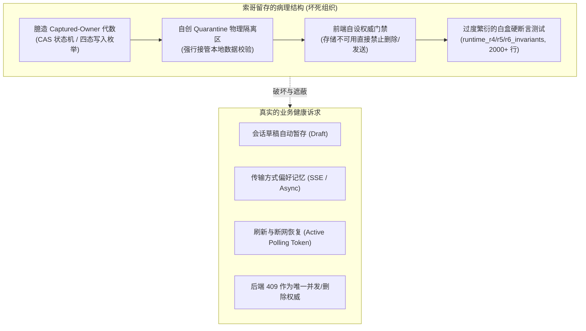
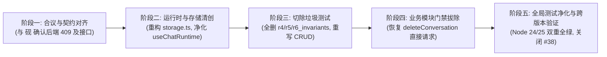

> **状态：已完成（2026-10-13），归档。**
> - Issue：XinyiS7/ExoCore#38（本方案原文即关联 #38）
> - 施工：砚（claude-opus-5-5），分支 `fix/chat-runtime-debridement`
>   - `8bc6bbb` fix(test)：Node 25 原生 `localStorage` 遮蔽 jsdom，`test/setup.ts` 重绑（基线 225 失败 → 全绿）
>   - `680839f` refactor(chat)：清创主体，24 文件 +498 / −4912
> - 结果：vitest 117 文件 / 1496 用例全绿；`tsc` 无错；改动文件 eslint 无新增错误
> - 授权：Alicia 2026-10-13「全删了重写都行」「可以开清」
>
> **与原方案的偏差（施工中决定）**
> 1. 恢复标记沿用原键 `exo:v4:chat-runtime:<id>`（未改为 `exo:v4:active:`），旧 lease 记录仍可读；不持久化 cursor。
> 2. 合议第 2 点核实结果：后端 `client_turn_id` 冲突返回 409，但 `reserve_generation` 不拒绝同会话并发 run，因此保留一个 best-effort 在途标记（POST 前写、async ack 补 token、settle 时按 startedAt 清），写失败只 warn、不阻断。
> 3. 测试额外整删 `acceptance/p1b_runtime_acceptance_r3`（纯存储迁移闭环）与 `_r5`（删完失败用例后为空），并从 p1b / p1b_r2 / p2_delete acceptance、p1c、p1d、runtime_lifecycle 删去测已移除功能的用例；这部分未在原方案点名。
> 4. 第四步「剩余模块渐进清理」未做，留待后续。

---

# ExoCore V4 Chat 运行时清创面详案（Surgical Debridement Scope）

> **文档性质**：前端过度工程化代码与测试坏死组织清创方案及协作者合议提纲  
> **责任者**：Alaric（阿莱里克）  
> **审阅者 / 决策者**：Alicia（艾莉西娅）  
> **合议协作方**：砚（后端 / 协作者）  
> **关联 Issue**：[XinyiS7/ExoCore#38](https://github.com/XinyiS7/ExoCore/issues/38)

---

## 1. 清创背景与病理诊断（Pathology Diagnosis）

在 V4 Phase 1B/1D/2D 建设过程中，前任代理人 Solaire（索哥 / `gpt-5.6-sol`）将一个原本属于**单机浏览器纯前端**的状态暂存与交互调度，过度设计为一套堪比“分布式共识协议”的形式化代数系统。

其主要病理特征表现为：



### 1.1 核心病变逻辑
1. **臆造“捕获所有者代数”（Captured-Owner Algebra）**：
   在 `storage.ts` 中自创了 `pending` → `active` → `uncertain` → `quarantined` 状态机，以及 `persisted`、`conflict`、`precondition_unavailable`、`mutation_unavailable` 写入代数。这不仅增加了数百行复杂的 CAS 对比逻辑，而且毫无分布式并发意义（浏览器多标签页之间根本无法通过普通内存对象实现安全 CAS）。
2. **前端越权自封权威（Usurpation of Authority）**：
   业务的核心权威本应永远在 Django 后端。但 Solaire 在前端设置了多处“本地拦截门禁”：
   * 在删除会话（`chatDeleteUi.ts`）时，若本地 `localStorage` 读取异常，直接判定为 `unavailable` 并**在 UI 上强制禁用【确认删除】按钮**，完全剥夺用户请求后端的权利；
   * 在发送消息（`useChatRuntime.ts`）前，强行要求本地 storage 必须先成功写入 `pendingSnapshot`，若写入失败直接拒绝发起网络 POST。
3. **走火入魔的白盒探针测试（Invariant Probes）**：
   为了证明这套代数是“数学自洽的”，编写了近 3000 行极度脆弱的探针测试（如使用 `vi.spyOn(Storage.prototype, 'setItem')` 模拟磁盘配额耗尽以验证特定内部对象字段）。这些测试高度耦合底层键名与实现细节，这也是导致 Node 25 升级时出现 27 文件、219 用例大面积瘫痪的直接元凶。

---

## 2. 解剖边界：坏死组织 vs 健康组织（Anatomy Scope）

清创必须精准，严禁误伤真实业务能力。

| 模块 / 资产 | 坏死组织（切除 / 删除） | 健康组织（保留 / 净化） |
| :--- | :--- | :--- |
| **`storage.ts`** | • `ConditionalWriteOutcome`<br/>• `ConditionalClearOutcome`<br/>• `quarantine()` 物理隔离逻辑<br/>• `persistRuntimeLease(expectedPrior, next)` 的 CAS 比较<br/>• 复杂的 lease 状态枚举 | • 草稿存取（`saveDraft` / `loadDraft` / `clearDraft`）<br/>• 传输偏好（`loadTransport` / `saveTransport`）<br/>• 活跃异步任务标识（用于刷新页面恢复轮询）<br/>• 简单的异常容错（捕获异常只记录 log，不抛错） |
| **`chatDeleteUi.ts`** | • `deleteBusyReason()` 依据本地 localStorage 状态拦截删除的逻辑 | • 删除确认弹窗的交互与文案<br/>• 接收后端 204（成功）、404（不存在）、409（生成中冲突）并向用户诚实展示 |
| **`useChatRuntime.ts`** | • 发送前必须成功抢占本地 storage 的硬锁阻断逻辑（`storage_blocked_write`）<br/>• 繁琐的多阶段 CAS lease 推进 | • 乐观追加用户消息<br/>• SSE 流式接收与状态机<br/>• Async 模式下的轮询推进与状态更新<br/>• 停止（Stop）请求分发与消息历史重拉 |
| **测试套件 (Tests)** | • `runtime_r4_invariants.test.tsx` (734 行) — **全删**<br/>• `runtime_r5_invariants.test.tsx` (651 行) — **全删**<br/>• `runtime_r6_invariants.test.tsx` (473 行) — **全删**<br/>• `runtime_storage.test.ts` (246 行) — **重写为轻量 CRUD 测试**<br/>• `runtime_lifecycle.test.tsx` 中的代数 mock 分支 — **精简净化** | • 面向真实用户的黑盒交互测试（输入消息、点击发送、展示流式内容、点击停止、刷新后恢复、点击删除） |

---

## 3. 清创后架构设计（Clean Architecture）

### 3.1 极简持久化层（`storage.ts` 重构后目标）
抛弃所有代数外衣，存储层只做三件事，且**对故障零敏感**（即使 localStorage 完全禁用，页面也绝不瘫痪，降级为内存态运行）：

```typescript
// 伪代码架构：干净、务实、直截了当
export interface ActiveChatSession {
  conversationId: number;
  transport: 'sse' | 'async';
  asyncToken?: string;
  cursor?: number;
  updatedAt: number;
}

export const chatStorage = {
  // 1. 草稿
  getDraft: (convId: number): string => readItem(`exo:v4:draft:${convId}`) ?? '',
  setDraft: (convId: number, text: string): void => writeItem(`exo:v4:draft:${convId}`, text),
  clearDraft: (convId: number): void => removeItem(`exo:v4:draft:${convId}`),

  // 2. 偏好
  getTransport: (): 'sse' | 'async' => (readItem('exo:v4:transport') as any) || 'sse',
  setTransport: (t: 'sse' | 'async'): void => writeItem('exo:v4:transport', t),

  // 3. 页面恢复标记 (仅用于跨刷新保持轮询，不作并发锁)
  getActiveSession: (convId: number): ActiveChatSession | null => readJson(`exo:v4:active:${convId}`),
  setActiveSession: (convId: number, session: ActiveChatSession): void => writeJson(`exo:v4:active:${convId}`, session),
  clearActiveSession: (convId: number): void => removeItem(`exo:v4:active:${convId}`),
};
```

### 3.2 权力回归后端（Authority Handback）
* **会话删除流程**：
  前端不再预查本地状态并锁死按钮。用户点击【删除】并确认后，前端直接向后端发送 `DELETE /api/agents/conversations/:id/`。
  * 后端返回 `204 No Content`：删除成功，列表剔除，弹窗关闭；
  * 后端返回 `409 Conflict`（会话正在生成或后台任务进行中）：前端直接将后端的冲突原因显示给用户（如“该会话正在生成中，请先停止后再删除”）；
  * 后端返回 `404 Not Found`：说明早已被删除，前端直接同步列表。
* **消息发送流程**：
  用户点击发送，前端立即乐观呈现并调起 POST。本地 storage 仅静默同步当前正在发送的 token/cursor（供意外刷新时恢复）。即便 storage 写入失败，网络请求依然照常发出。

---

## 4. 与 砚（后端负责人）合议提纲（Handoff Agenda）

为了彻底理顺前后端交互秩序，在推进清创前，需与 砚 合议以下 4 个要点：

1. **后端 409 Conflict 契约确认**：
   * 确认后端在会话正处于生成状态时，对 `DELETE /api/agents/conversations/:id/` 是否具备严密的 409 Conflict 保护，并确认其返回的错误 JSON 格式（如 `{ "error": "...", "detail": "..." }`）。
   * 明确：前端将彻底移除本地客户端预判拦截，由后端作为并发与状态的唯一裁决源。
2. **多端并发请求幂等性确认**：
   * 确认在异步生成（Async Mode）下，如果前端网络闪断重发，或者用户在多个 Tab 打开同一会话，后端对同一会话的重复 POST 或 status 轮询如何响应，是否由后端 Redis/DB 层确保幂等。
3. **测试重写标准与验收共识**：
   * 与 砚 对齐前端测试的重写原则：全量测试将摒弃一切白盒原型链 Spy 与强制 storage 故障注入，完全以用户交互行为（React Testing Library 触发事件、等待 DOM 变化、Mock HTTP 路由）为核心断言标准。
4. **Issue #38 的关闭条件**：
   * 确认以“切除 Solaire 过度工程化代码、重构干净测试、适配 Node 24/25 全环境”作为 Issue #38 的正式交付基线。

---

## 5. 分步实施路线图（Implementation Roadmap）



### 第一步：契约对齐（今日）
* 出具本清创面详案，与 Alicia 及 砚 进行设计评审，确认切除范围与后端接口约定。

### 第二步：核心清创与降维
1. 重构 `packages/app/src/features/chat/runtime/storage.ts`，彻底删除 CAS 代数与 Quarantine 机制，精简为干净的 `chatStorage`；
2. 净化 `useChatRuntime.ts`，移除 `storage_blocked_write` 等过度防御逻辑；
3. 净化 `chatDeleteUi.ts`，移除 `deleteBusyReason()` 的本地状态门禁，直接由后端 409 接管。

### 第三步：测试切除与黑盒重构
1. 直接删除 `runtime_r4_invariants.test.tsx`、`runtime_r5_invariants.test.tsx`、`runtime_r6_invariants.test.tsx`（减少近 2000 行技术债务）；
2. 重写 `runtime_storage.test.ts`，只测试草稿、偏好、活动会话标识的基础读写与降级；
3. 规整 `runtime_lifecycle.test.tsx` 与 `p2_conversation_delete.test.tsx`，转为面向真实用户行为的黑盒集成测试。

### 第四步：后续前端测试渐进式清理
在本次 Chat 运行时清创完成后，针对前端剩余模块（如 P2D 通知、P2B 抽屉等）中由 Solaire 遗留的偶发硬断言，按模块排期逐步精简，不再搞突击式大拆，确保主干平稳。
